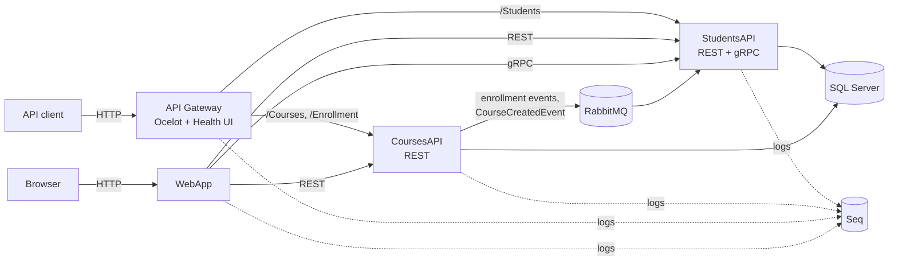

# University Microservices

A small university management system built as a set of .NET microservices, running on **Docker Compose** locally and deployed to **Kubernetes**. It demonstrates common microservice patterns: an API gateway, synchronous REST and gRPC calls, asynchronous messaging over RabbitMQ (raw client and MassTransit), health monitoring and centralized structured logging.

Individual project for the **Paslaugų programavimas debesų kompiuterijoje** (Cloud Service Programming) course at Kaunas University of Technology (KTU), 3rd year. It extends the course's lab-based StudentsAPI/CoursesAPI sample (built on the lecturer's notes and samples) with five new features and a Kubernetes deployment.

## Architecture



| Service | Responsibility |
|---|---|
| **StudentsAPI** | Students and enrollments CRUD (EF Core, SQL Server). Also a gRPC server, a RabbitMQ 7.x subscriber for enrollment messages and a MassTransit consumer for `CourseCreatedEvent`. REST on `8080`, gRPC on `5001`. |
| **CoursesAPI** | Courses CRUD. Publishes enrollment messages (raw RabbitMQ client) and `CourseCreatedEvent` (MassTransit). |
| **ApiGateway** | Ocelot gateway — single external entry point (`/Students`, `/Courses`, `/Enrollment`). Hosts the HealthChecks UI dashboard at `/health-ui`. |
| **WebApp** | ASP.NET Core MVC front end; talks to the services directly over REST and gRPC. |
| **Contracts** | Shared message contracts (`CourseCreatedEvent`). |
| SQL Server, RabbitMQ, Seq | Infrastructure containers. |

## Features

- **API gateway** with Ocelot; in Kubernetes the routes are injected from a ConfigMap, so they change without rebuilding the image
- **gRPC** service-to-service calls (`StudentsAPI/Protos/students.proto`)
- **Event-driven messaging** over RabbitMQ — both the raw `RabbitMQ.Client` 7.x API and MassTransit
- **Health checks** for SQL Server and RabbitMQ (custom check) on every service, aggregated in a HealthChecks UI dashboard
- **Centralized structured logging** with Serilog → Seq
- **Kubernetes manifests**: Deployments, Services (ClusterIP / NodePort), PersistentVolumeClaims, a ConfigMap and a Secret

## Tech stack

C# / .NET 8, ASP.NET Core (Web API, MVC), EF Core, SQL Server 2019, RabbitMQ, MassTransit, gRPC, Ocelot, Serilog, Seq, AspNetCore.HealthChecks, Docker, Docker Compose, Kubernetes (Docker Desktop / kind).

## Running it

Credentials are not stored in the repo. Create a `.env` from the template first — both Docker Compose and the Kubernetes deploy script read it:

```bash
cp .env.example .env    # then edit the values
```

### Docker Compose

```bash
docker compose up --build
```

| URL | What |
|---|---|
| http://localhost:6090 | WebApp (MVC) |
| http://localhost:6080/Students | Students via the API gateway |
| http://localhost:6080/health-ui | Health checks dashboard |
| http://localhost:6082/swagger, http://localhost:6081/swagger | StudentsAPI / CoursesAPI Swagger |
| http://localhost:6340 | Seq logs |
| http://localhost:16672 | RabbitMQ management (credentials from `.env`) |

### Kubernetes (Docker Desktop with kind)

```powershell
.\k8s\deploy.ps1      # builds images, loads them into the cluster, creates the Secret from .env, applies the manifests
.\portforward.ps1     # optional: port-forwards if NodePorts aren't reachable
.\k8s\teardown.ps1    # remove everything
```

| URL | What |
|---|---|
| http://localhost:30090 | WebApp |
| http://localhost:30080/Students | API gateway |
| http://localhost:30080/health-ui | Health checks dashboard |
| http://localhost:30082/api/Students, http://localhost:30081/api/Courses | Services directly |
| http://localhost:30340 | Seq logs |
| http://localhost:30672 | RabbitMQ management |

```bash
kubectl get pods -n university
kubectl logs <pod-name> -n university
kubectl scale deployment studentsapi --replicas=0 -n university   # watch the health dashboard go red
```

## Project layout

```
ApiGateway/    Ocelot gateway + HealthChecks UI (ocelot.json for Compose)
StudentsAPI/   REST + gRPC + RabbitMQ/MassTransit consumers
CoursesAPI/    REST + RabbitMQ/MassTransit publishers
WebApp/        MVC client (REST + gRPC)
Contracts/     shared MassTransit message contracts
k8s/           Kubernetes manifests + deploy/teardown scripts
docker-compose.yml, docker-compose.override.yml
```
